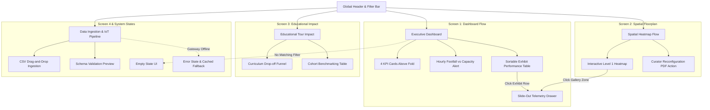

# Heritage Visitor Analytics System (CuratorPulse)

> **Problem Statement:** Heritage sites and museums struggle to understand visitor engagement patterns and optimize educational experiences. A visitor analytics system could improve cultural tourism outcomes.

CuratorPulse is a modern, analytical web-based intelligence platform designed for museums, heritage monuments, and cultural tourism operators. By synthesizing data from IoT Bluetooth Low Energy (BLE) beacons, ticketing counters, and interactive QR mobile guides, CuratorPulse enables museum leadership, curators, and educators to measure dwell times, eliminate crowd bottlenecks, revitalize underutilized dead zones, and maximize student curriculum retention.

---

## Mock UX Design

**Interactive Prototype / Live Design Link:**  
👉 **[CuratorPulse Live Interactive Mock UX Prototype](https://hareesh040122.github.io/heritage-visitor-analytics/mock-ux/)**  
*(Direct local file: `mock-ux/index.html` or view the [Full Mock UX Design Specification](docs/MOCK_UX_SPECIFICATION.md))*  
*(Figma / Canvas Wireframe Link: [CuratorPulse Figma & UI Wireframe Board](https://www.figma.com/design/curatorpulse-heritage-analytics-mock-ux))*

This mock UX demonstrates the application's primary screens, navigation flow, and major user journeys for museum curators, directors, and educational coordinators to monitor visitor dwell time, optimize exhibit layouts, and enhance cultural tourism outcomes.

---

### Core Wireframe Screens & Workflows

CuratorPulse provides a workflow-first user experience organized into five distinct analytical screens:

1. **Executive Overview Dashboard (Monitor Mode):**
   * **5-Second Scan Rule:** Positioned strictly **above the fold**, four vital health KPI cards show *Total Footfall (18,450)*, *Average Dwell Time (54.2 mins)*, *Educational Engagement Rate (71.8%)*, and *Zone Choke Alerts (2 Zones Flagged)*.
   * **Focused Insights:** Exactly two high-impact charts—*Hourly Footfall vs. Safe Capacity Threshold (1,200 visitors/hr)* and *Exhibit Wing Dwell vs. Educational Interaction %*.
   * **Summary Before Detail:** A sortable, paginated exhibit performance table with single-click telemetry drill-down triggers.

2. **Spatial Floorplan & Heatmap Flow (Explore & Investigate Modes):**
   * An interactive schematic floorplan of Level 1 galleries with live dwell and density heat maps.
   * Visual indicators highlighting the Central Rotunda chokepoint and the Decorative Pottery dead zone.
   * Automated curator layout recommendations (e.g. staggering school group entry vectors by 20 minutes).

3. **Slide-Out Granular Telemetry Drawer (Investigate Mode):**
   * A non-blocking side drawer that slides into view upon clicking any artifact (e.g. *Rosetta Stone Replica*).
   * Displays micro-dwell histograms (*Glance <30s*, *Skim 30s-3m*, *Deep Study >5m*), bounce rates, and audio guide play-through rates without losing dashboard context.

4. **Educational Tour Impact (Compare & Filter Modes):**
   * Curriculum completion funnel tracking student retention across historical milestone checkpoints.
   * Side-by-side cohort benchmarking comparing docent-guided school tours (+51% dwell time, +18% quiz score) against self-guided QR mobile tours.

5. **Data Ingestion & IoT Sensor Pipeline (Ingestion Mode):**
   * Drag-and-drop batch upload supporting `.csv`, `.tsv`, and `.json` ticketing logs with real-time schema validation preview.
   * Live telemetry monitoring for 14 active BLE beacon arrays and turnstile gateway webhooks.

6. **Empty & Error Recovery States (Resilience & Usability):**
   * **Empty State:** Friendly filter mismatch UI explaining why zero records matched and providing a one-click *"Clear All Filters"* button.
   * **Error State:** Graceful MQTT gateway disconnection recovery displaying cached fallback data and a one-click *"Retry Connection"* trigger.

---

## 5 Analytical User Modes Supported

CuratorPulse is engineered specifically around the cognitive modes of analytical product users:

| User Mode | User Persona | Primary Workflow | Key UI Element |
| :--- | :--- | :--- | :--- |
| 📡 **Monitor** | Museum Director | 2-minute daily check on museum footfall & safety limits | 4 Top KPI Cards above the fold |
| 🔭 **Explore** | Exhibition Curator | Browsing spatial floorplans to uncover visitor patterns | Interactive Gallery Heatmap |
| ⚖️ **Compare** | Education Lead | Benchmarking guided vs self-guided student cohorts | Cohort Comparison Matrix & Funnel |
| 🔍 **Filter** | Operations Staff | Isolating data by date range, museum wing, and visitor type | Sticky Top Filter Bar (Apply / Reset) |
| 🧩 **Investigate**| Head Curator | Drilling into 14:00 congestion spikes & dead-zone drop-offs | Slide-out Telemetry Drawer |

---

## Navigation & Workflow Architecture



---

## 10 Core Mock UX Elements Checklist

- [x] **1. Dashboard Layout:** 64px persistent sidebar, sticky filter bar, responsive card grid.
- [x] **2. Navigation:** Menu hierarchy with active pills, badge indicators, and museum site context.
- [x] **3. KPI Cards:** 4 metrics above the fold with delta indicators (+/- vs baseline) and sub-targets.
- [x] **4. Filters:** Date range, Museum Wing, and Visitor Demographics with single-click Apply/Reset.
- [x] **5. Data Tables:** Sortable columns, dwell time rankings, pagination (1-3), and row actions.
- [x] **6. Charts:** Maximum 2 charts per view with explicit axes, safety threshold lines, and annotations.
- [x] **7. Ingestion Flow:** Drag-and-drop CSV upload zone, file validation preview, and IoT sensor statuses.
- [x] **8. Error States:** Network/sensor failure UI with cached data fallback and retry button.
- [x] **9. Empty States:** Friendly "No results found" prompt with actionable "Clear Filters" button.
- [x] **10. User Actions:** Export CSV/PDF brief, granular telemetry drawer, search, and layout optimization.

---

## Documentation & Video Walkthrough Links

* 📄 **[Detailed Mock UX Specification Document](docs/MOCK_UX_SPECIFICATION.md)** — In-depth breakdown of user personas, information hierarchy, layout wireframes, and design rationale.
* 🎥 **[Video Walkthrough Script & Recording Guide](docs/VIDEO_WALKTHROUGH_SCRIPT.md)** — Complete 3-to-5 minute screen-share presentation script and Google Drive sharing instructions.
* 💻 **[Interactive Prototype Source](mock-ux/index.html)** — Pure HTML5/Tailwind/JS prototype ready for local testing or GitHub Pages hosting.

---

## How to Test Locally

1. Clone or download the repository:
   ```bash
   git clone https://github.com/hareesh040122/heritage-visitor-analytics.git
   cd heritage-visitor-analytics
   ```
2. Open the prototype directly in any web browser:
   * Windows: Double-click `mock-ux/index.html` or run:
     ```powershell
     Start-Process "mock-ux/index.html"
     ```
   * macOS / Linux:
     ```bash
     open mock-ux/index.html
     ```
3. Test all interactions:
   * Switch between analytical modes (`Monitor`, `Explore`, `Compare`, `Filter`, `Investigate`).
   * Navigate between the 5 screens using the left sidebar.
   * Click any exhibit in the table or floorplan zone to open the slide-out telemetry drawer.
   * Test the filter bar and the Empty/Error state wireframes.
