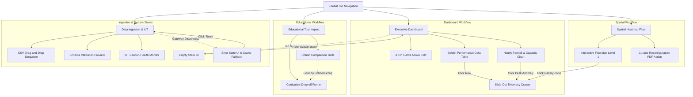

# CuratorPulse: Heritage & Museum Visitor Analytics System
## Module 1.4: Mock UX & User Flow Design Specification

> **Project Topic:** Heritage sites and museums struggle to understand visitor engagement patterns and optimize educational experiences. A visitor analytics system could improve cultural tourism outcomes.  
> **Course Module:** 1.4 Mock UX & User Flow Design  
> **Repository:** [https://github.com/hareesh040122/heritage-visitor-analytics](https://github.com/hareesh040122/heritage-visitor-analytics)  
> **Target Stack:** MERN (MongoDB Time-Series, Express.js, React.js, Node.js) with IoT Beacon & QR telemetry  

---

## 1. Executive Summary & Design Philosophy

Cultural heritage sites, national monuments, and museums face a shared dilemma: while physical visitor footfall can be high, site directors and curators often operate in the dark regarding **dwell patterns**, **exhibit engagement**, **dead zones**, and **educational curriculum retention**. 

Before building backend aggregations, writing React components, or deploying database collections, professional engineering teams create a **Mock UX**. As emphasized in Product Design Planning:
* **Mock UX is a planning artifact, not a visual decoration deliverable.** It answers *"How does this product actually work?"* before engineering tackles *"How do we build this?"*
* **The 10x Cost Rule:** Discovering that a museum curator needs to compare school groups vs. general tourists in Sprint 1 takes 5 minutes to adjust in a wireframe. Discovering it in Sprint 4 requires redesigning database schemas, rewiring API endpoints, and 3 weeks of expensive engineering rework.

This document and the companion interactive prototype define the end-to-end user experience, navigation flows, and screen hierarchies for **CuratorPulse**.

---

## 2. Target Personas & Core User Journeys

| Persona | Primary Goal | Dominant Analytical Mode | Primary Screens Visited |
| :--- | :--- | :--- | :--- |
| **Dr. Elena Vance**<br>*Museum Director & Operations* | Monitor daily footfall, ensure safe zone capacities, benchmark seasonal cultural tourism outcomes | 📡 **Monitor** & ⚖️ **Compare** | Executive Dashboard, Executive Export Brief |
| **Marcus Holloway**<br>*Chief Curator & Exhibition Designer* | Identify low-dwell "dead zones", evaluate artifact layout flow, investigate visitor drop-off along physical pathways | 🔭 **Explore** & 🧩 **Investigate** | Spatial Floorplan Heatmap, Exhibit Telemetry Drawer |
| **Amina Patel**<br>*Educational Program Coordinator* | Measure school curriculum tour completion, compare QR audio guides vs. docent tours, maximize student knowledge retention | ⚖️ **Compare** & 🔍 **Filter** | Educational Tour Impact, Curriculum Drop-off Funnel |
| **Kavita Roy**<br>*IoT & Facilities Administrator* | Manage physical BLE beacons, verify turnstile sensor health, batch-upload external ticketing CSV logs | 🔍 **Filter** & 📤 **Ingest** | Data Ingestion & Sensor Pipeline, Error State Recovery |

---

## 3. The 5 Analytical User Modes (Workflow-First Design)

Analytical dashboards serve users in fundamentally different mental states than consumer apps. CuratorPulse is purpose-built to support all five modes:

```
           ┌───────────────────────────────────────────────┐
           │          1. MONITOR MODE (5-sec scan)         │
           │  4 KPI Cards above fold · Capacity threshold  │
           └───────────────────────┬───────────────────────┘
                                   │
              ┌────────────────────┴────────────────────┐
              ▼                                         ▼
┌───────────────────────────┐             ┌───────────────────────────┐
│     2. EXPLORE MODE       │             │     3. COMPARE MODE       │
│ Spatial Gallery Floorplan │             │ Guided vs Self-Guided     │
│ Visual Dwell Heatmaps     │             │ Weekday vs Weekend Cohort │
└─────────────┬─────────────┘             └─────────────┬─────────────┘
              │                                         │
              └────────────────────┬────────────────────┘
                                   ▼
           ┌───────────────────────────────────────────────┐
           │              4. FILTER MODE                   │
           │ Date Range · Museum Wing · Visitor Demographic│
           └───────────────────────┬───────────────────────┘
                                   │
                                   ▼
           ┌───────────────────────────────────────────────┐
           │            5. INVESTIGATE MODE                │
           │ Slide-out Telemetry Drawer · Granular Dwell   │
           │ Drop-off Histogram · Layout Recommendation    │
           └───────────────────────────────────────────────┘
```

1. **📡 Monitor Mode:** A director opens the dashboard at 9:00 AM for a 2-minute scan. With **4 KPI cards positioned above the fold**, they verify that total footfall is +14.8%, average dwell is 54.2 mins, and no galleries exceed the 1,200 visitors/hr safety limit without having to scroll.
2. **🔭 Explore Mode:** A curator explores the spatial floorplan without a specific hypothesis, scanning the color-coded density to see that the North Gallery "Decorative Pottery" is underperforming.
3. **⚖️ Compare Mode:** The education coordinator compares student cohorts on docent-led tours vs. mobile QR app tours to see that docent tours achieve a +51% dwell time and +18% higher quiz score.
4. **🔍 Filter Mode:** Users narrow their context (e.g., *East Wing Antiquities* + *School Groups* + *Past 7 Days*) using the top persistent filter bar, which features single-click apply and reset.
5. **🧩 Investigate Mode:** When an anomaly is detected (e.g. 2 zones flagged for bottleneck crowding), clicking the row or zone slides out a **Granular Telemetry Drawer**, preserving the dashboard context while revealing exact drop-off histograms and bounce rates.

---

## 4. The 10 Core Elements Implementation Matrix

Every wireframe screen has been audited against the 10 essential analytical UI elements:

| # | Core Element | Implementation in CuratorPulse | Engineering Specification |
| :-: | :--- | :--- | :--- |
| **1** | **Dashboard Layout** | Structured 3-zone layout: 64px persistent sidebar, 56px sticky filter/action header, responsive main content canvas. | CSS Flexbox/Grid; standard container bounds `max-w-7xl`. |
| **2** | **Navigation** | Sidebar menu with icons, active state pill (`bg-indigo-600 text-white`), live status badge, and user site context. | React Router `/dashboard`, `/spatial`, `/education`, `/ingestion`. |
| **3** | **KPI Cards** | 4 primary cards above the fold: Metric title, large mono value, delta indicator (+/- vs baseline), and mini sub-target. | Component `<KPICard title value delta subtext />`. |
| **4** | **Filters** | Date range picker, Wing/Gallery dropdown, Visitor Segment dropdown, single-click "Apply" & "Reset" buttons. | Centralized React state `filterState = { date, wing, demo }`. |
| **5** | **Data Tables** | Sorted by dwell time descending, with status pills, pagination (1-3), and row-level drill-down triggers. | React `<ExhibitTable />` with client-side sorting and row click handlers. |
| **6** | **Charts** | Strictly 2 focused charts per screen: Chart 1 (Hourly Footfall vs Capacity Alert) & Chart 2 (Dwell vs Engagement). | Recharts `<AreaChart />` and `<BarChart />` with explicit axes & tooltips. |
| **7** | **Ingestion Flow** | Drag-and-drop file dropzone accepting `.csv`, `.tsv`, `.json`, real-time schema validation feedback, and IoT gateway statuses. | Multer / PapaParse streaming parser with MongoDB bulk upsert. |
| **8** | **Error States** | Graceful sensor disconnection screen showing fallback cached data, time of last sync, and a prominent "Retry" CTA. | Error Boundary UI; never displays unhandled stack traces. |
| **9** | **Empty States** | Friendly state for "No search results match filters" with "Clear Filters" CTA; plus "New Museum Site Onboarding" setup screen. | Empty state container with actionable CTA buttons. |
| **10**| **User Actions** | Primary "Export CSV / PDF Executive Brief", "Telemetry Drawer" slideout, "Apply Filters", and "Re-upload CSV". | Asynchronous CSV generation with browser `Blob` download. |

---

## 5. Screen-by-Screen Wireframe Layouts

### Screen 1: Executive Overview Dashboard
*Mode: Monitor & Summary Scan (5-Second Scan Rule)*

```
+---------------------------------------------------------------------------------------------------------+
| [LOGO] CuratorPulse  |  Active Mode: [📡 Monitor]  |  Site: National Museum #4 (Curator: Dr. Vance)     |
+---------------------------------------------------------------------------------------------------------+
| [FILTERS]: Date: [Past 7 Days v]  Wing: [All Wings v]  Visitor: [All Segments v]  [Apply] [Reset]        |
+---------------------------------------------------------------------------------------------------------+
| 💡 Wireframe Annotation: 4 KPI Cards placed above the fold for immediate operational health scan       |
|                                                                                                         |
| +--------------------+ +--------------------+ +--------------------+ +---------------------------------+ |
| | Total Footfall     | | Avg Dwell Time     | | Educational Eng.   | | Zone Choke Alerts               | |
| | 18,450             | | 54.2 mins          | | 71.8%              | | 2 Zones ⚠️                      | |
| | +14.8% vs last wk  | | +6.1 min baseline  | | +8.4% QR/Audio     | | >92% Capacity [View Map ->]     | |
| +--------------------+ +--------------------+ +--------------------+ +---------------------------------+ |
|                                                                                                         |
| [CHART 1: Hourly Footfall & Safety Threshold]       [CHART 2: Wing Dwell vs Educational Engagement]     |
| 1.4k|             /--\ (14:00 Peak Alert ⚠️)       Antiquities:   ====================== (22m, 84% QR) |
| 1.2k| - - - - - -/ - -\- - - [Safety Cap] - - -     Renaissance:   ================ (18m, 68% QR)       |
| 0.8k|      /----/      \----\                      STEM Lab:      ========================== (28m, 91%)|
| 0.4k| ----/                  \----                 Pottery:       ===== (3.8m, 19% QR - DEAD ZONE 📭)  |
| 0.0k+-----------------------------                 0%             50%            100%                   |
|     09:00  11:00  13:00  15:00  17:00              Action: Investigate Pottery corridor drop-off        |
|                                                                                                         |
| [TABLE: Exhibit & Gallery Performance Telemetry]   [Search Artifact...] [Sort: Dwell Time v]            |
| +--------------------------------------+---------------------+-------------+-----------+--------------+ |
| | Exhibit / Artifact Name              | Wing / Gallery      | Visitors    | Dwell     | Action       | |
| +--------------------------------------+---------------------+-------------+-----------+--------------+ |
| | Rosetta Stone & Hieroglyphics        | East Antiquities    | 9,410       | 18.4 min  | [Drill Down] | |
| | Leonardo Da Vinci Folio              | West Renaissance    | 6,820       | 14.2 min  | [Drill Down] | |
| | Decorative Pottery (Dead Zone) ⚠️    | North Gallery       | 1,120       | 3.8 min   | [Investigate]| |
| | Interactive Heritage VR Sandbox      | South STEM Lab      | 8,200       | 26.5 min  | [Drill Down] | |
| +--------------------------------------+---------------------+-------------+-----------+--------------+ |
| Showing 4 of 28 Exhibit Zones                                [Prev] [1] [2] [3] [Next]                  |
+---------------------------------------------------------------------------------------------------------+
```

---

### Screen 2: Spatial Floorplan & Heatmap Flow
*Mode: Explore & Investigate (Spatial Optimization)*

```
+---------------------------------------------------------------------------------------------------------+
| [MAP VIEW]: Floor 1 Gallery Schematics             | Legend: [*] Optimal  [!] High Density  [#] Dead    |
+---------------------------------------------------------------------------------------------------------+
|                                                                                                         |
|  +---------------------------+  +---------------------------+  +---------------------------+            |
|  | EAST WING: ANTIQUITIES    |  | CENTRAL ROTUNDA CHOKE     |  | WEST WING: RENAISSANCE    |            |
|  | Dwell: 22.4 mins          |  | Density: 94% (Near Limit!)|  | Dwell: 18.1 mins          |            |
|  | Status: High Engagement   |  | Status: BOTTLENECK ⚠️     |  | Status: Balanced          |            |
|  | [Click to Inspect ↗]      |  | [Click to Inspect ↗]      |  | [Click to Inspect ↗]      |            |
|  +---------------------------+  +---------------------------+  +---------------------------+            |
|                                                                                                         |
|  ================================== TOUR VECTOR (72% FLOW) ===========================================  |
|                                                                                                         |
|  +---------------------------------------------+  +---------------------------------------------+       |
|  | NORTH CORRIDOR: DECORATIVE POTTERY          |  | SOUTH WING: HERITAGE STEM LAB               |       |
|  | Dwell: 3.8 mins (Fast walkthrough)          |  | Dwell: 28.6 mins (Interactive Kiosks)       |       |
|  | Status: DEAD ZONE 📭                         |  | Status: Peak Student Engagement             |       |
|  | [Click to Inspect ↗]                        |  | [Click to Inspect ↗]                        |       |
|  +---------------------------------------------+  +---------------------------------------------+       |
|                                                                                                         |
|  [CURATOR RECOMMENDATION PANEL]:                                                                        |
|  1. Alleviate Central Rotunda: Stagger school group arrivals by 20 mins to eliminate 14:00 congestion.  |
|  2. Revitalize Pottery Corridor: Position interactive digital quest kiosk at north portal entrance.    |
+---------------------------------------------------------------------------------------------------------+
```

---

### Screen 3: Slide-Out Granular Telemetry Drawer
*Mode: Investigate (Triggered on click of any exhibit or zone)*

```
                                                     +----------------------------------------------------+
                                                     | [X] GRANULAR TELEMETRY INSPECTOR                   |
                                                     +----------------------------------------------------+
                                                     | Exhibit: Rosetta Stone Replica & Hieroglyphs       |
                                                     | Wing: East Wing Antiquities · Beacon ID: BC-03     |
                                                     |                                                    |
                                                     | [METRICS SNAPSHOT]:                                |
                                                     | Weekly Visitors: 9,410      Avg Dwell: 18.4 mins   |
                                                     | Audio Guide Plays: 7,720    Bounce Rate: 4.2%      |
                                                     |                                                    |
                                                     | [DWELL TIME DISTRIBUTION HISTOGRAM]:               |
                                                     | Glance  (<30s):   [==          ]  8%               |
                                                     | Skim    (30s-3m): [======      ] 24%               |
                                                     | Study   (>5m):    [================] 68% (Strong)  |
                                                     |                                                    |
                                                     | [CURATOR OPTIMIZATION NOTE]:                       |
                                                     | Exceptional dwell retention. Recommend placing a   |
                                                     | feedback touchpoint here to boost tour completion. |
                                                     |                                                    |
                                                     | [Export Exhibit CSV]                [Close Drawer] |
                                                     +----------------------------------------------------+
```

---

### Screen 4: Data Ingestion & Sensor Pipeline
*Mode: Ingestion & Telemetry Health*

```
+---------------------------------------------------------------------------------------------------------+
| BATCH CSV / TSV TOURISM DATA INGESTION              | CONNECTED SENSOR GATEWAYS                         |
+-----------------------------------------------------+---------------------------------------------------+
| + - - - - - - - - - - - - - - - - - - - - - - - - + | [x] East Wing BLE Array (8 Nodes)      - 120 pkt/s|
| |       [ 📁 Drag & Drop CSV Here ]               | | [x] Mobile QR Guide Webhook API         - Active  |
| |    Accepts: visitor_footfall_export.csv         | | [x] Main Turnstile Optical Counter     - Polling  |
| |    [ Browse Computer ]                          | |                                                   |
| + - - - - - - - - - - - - - - - - - - - - - - - - + | Pipeline Status: ALL SYSTEMS OPERATIONAL (0 ERRORS)|
|                                                     |                                                   |
| [VALIDATION PREVIEW]:                               | Database: MongoDB Time-Series Collection Ready    |
| File: oct_ticketing_data.csv                        | Ingestion Rate: ~450 telemetry events / minute    |
| Status: 1,840 records parsed · 0 schema errors      |                                                   |
| [ Confirm & Ingest to Database ]                    | [ Gateway Health Diagnostic Log ]                 |
+-----------------------------------------------------+---------------------------------------------------+
```

---

### Screen 5: Empty & Error Recovery States
*Mode: Edge Case & Graceful Fallback*

```
+-----------------------------------------------------+---------------------------------------------------+
| EMPTY STATE (Filter Mismatch)                       | ERROR STATE (Sensor Gateway Failure)              |
+-----------------------------------------------------+---------------------------------------------------+
|                    [ 📭 ]                           |                    [ ⚠️ ]                         |
|     No Visitor Records Match Selected Filter        |         Sensor Telemetry Stream Offline           |
|                                                     |                                                   |
| No records found for "Decorative Pottery" in July.  | Lost connection to MQTT Gateway 'gw-eastwing-04'. |
| Broaden your search criteria or reset filters.      | Currently displaying cached data from 10:45 AM.   |
|                                                     |                                                   |
| [ Reset All Filters ]   [ Return to Dashboard ]     | [ 🔄 Retry Connection ]   [ View Diagnostics ]    |
+-----------------------------------------------------+---------------------------------------------------+
```

---

## 6. End-to-End Navigation Flow Diagram



---

## 7. Good UX vs. Bad UX Analysis

| Dimension | ❌ Bad Mock UX Pattern (What to Avoid) | ✅ CuratorPulse Good Mock UX Implementation | Design Rationale & Business Justification |
| :--- | :--- | :--- | :--- |
| **Chart Density** | 12 charts dumped on one page with infinite scroll. | Strictly **2 focused charts per screen**. | Eliminates cognitive overload; each chart answers one specific PRD operational question. |
| **Filter Placement** | Filters placed at the bottom or hidden inside nested submenus. | **Top-right persistent sticky bar** with single-click Apply/Reset. | Directors and curators start every session by narrowing date and wing parameters. |
| **Information Hierarchy** | Raw data tables placed first; KPIs buried under charts. | **Summary before detail:** 4 KPIs first, 2 charts second, sortable table third. | Supports the **5-second scan rule** for busy museum managers. |
| **Drill-down Experience** | Opening separate page routes or full-screen modal traps that lose context. | **Slide-out telemetry drawer** on right edge. | Users inspect exhibit-level anomalies without losing their place in the table or floor plan. |
| **Edge-Case Handling** | Blank white page on filter mismatch; unhandled 500 error code. | Purpose-built **Empty & Error screens** with contextual recovery CTAs. | Preserves trust; staff understand why data is missing and how to recover immediately. |

---

## 8. Pre-Submission Review Checklist

- [x] **Can another engineer understand the workflow without explanation?** Yes, every component carries clear descriptive labels (e.g. *"Sortable · Paginated"*, *"Benchmark: >15m"*).
- [x] **Are KPI metrics visible above the fold?** Yes, positioned directly below the filter header, visible on standard 1080p and laptop viewports without scrolling.
- [x] **Are filters logically placed with interaction models explicit?** Yes, top sticky bar indicates filter types (Date, Wing, Segment) and has both "Apply" and "Reset" triggers.
- [x] **Is navigation structure intuitive?** Yes, persistent left sidebar with clear icons, active states, and less than 2 clicks to reach any view.
- [x] **Are error and empty states represented?** Yes, both filter mismatch empty states, first-time site onboarding, and sensor gateway dropouts are wireframed.
- [x] **Does each chart drive a business decision?** Yes, Chart 1 drives crowd re-routing at 14:00; Chart 2 identifies the Decorative Pottery dead zone for layout optimization.
- [x] **Does the interface solve the PRD problem statement?** Yes, it equips curators and directors to track visitor dwell time, eliminate bottlenecks, and enhance cultural tourism outcomes.

---

## 9. Technical Architecture Handoff Notes (MERN Stack)

* **Frontend:** React.js, Tailwind CSS, Lucide-React / FontAwesome icons, Recharts for data visualization.
* **Backend:** Node.js with Express.js REST API:
  * `GET /api/analytics/overview` — Aggregated KPI metrics & hourly trends.
  * `GET /api/analytics/spatial` — Gallery zone dwell times & flow vectors.
  * `POST /api/ingestion/upload` — Multipart CSV stream ingestion with validation.
  * `GET /api/sensors/health` — MQTT / WebSocket heartbeat status for BLE beacons.
* **Database:** MongoDB Time-Series Collections (`visitor_telemetry` and `exhibit_dwell_logs`) with compound indexes on `(timestamp, exhibit_id, site_id)`.
